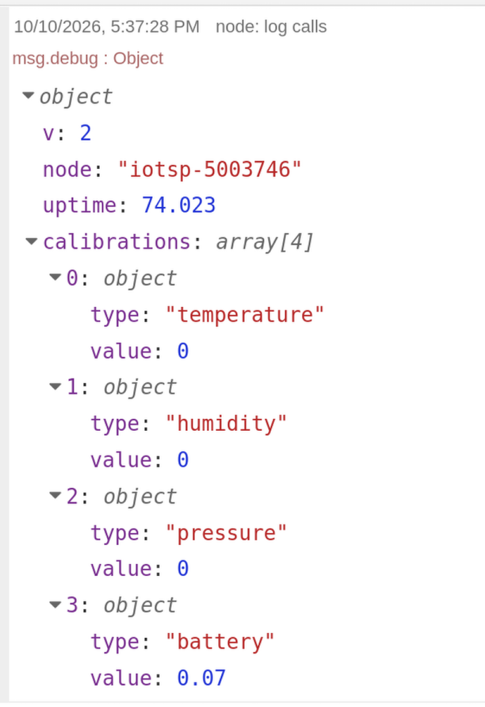

# User Guide
This outline is currently a work-in-progress.

## Toolchain Installation
### Minimal
### Arduino

## Sensor Setup
### Sensor Stackup/Compatibility
### Battery Installation/USB Power
### Programming
- flash.sh
- tethered/battery FW
### Configuration
- WiFi Manager
- Sensor Names (see aliases below)
- Server address (see below)
### Debugging (see below)

## Server Setup
* [Server Setup and Configuration](server_setup.md)

### Debugging (see below)

## Sensor Calibration
- Potential Methods
- VCC calibration firmware
- WiFi Manager
- OTA

## OTA Updates
### Firmware
- git pull
- manual copy

### Sensor Configuration
Many aspects of the sensor configuration that can be adjusted via WiFi Manager
configuration can also be updated remotely by creating text files in the
`sensor-cfg` directory ([more information](server_setup.md#link-the-firmware-and-sensor-cfg-directory)).

First, it is recommended to view the sensor's current settings in Node-RED when
it reports in:


Above, we can see the node name (iotsp-5003746) and the current value of the
sensor calibrations.

In order to configure any of the node's settings, first create a directory
in `sensor-cfg` with the same name as the node.
```bash
cd sensor-cfg
# in the example above nodename would be "iotsp-5003746"
mkdir [nodename]
```

Within this node-name directory, create text files with the content of the new
configuration values you want to set. If you provide a file whose contents are
a single space, " ", then this will effectively restore the sensor node's
default value for that parameter.

The list of valid file names can be found by searching for "persistent storage
file names" in [project_config.h](../../project_config.h).
Here is the current list:
* node_name
* report_host_name
* report_host_port
* clock_drift_calibration
* temperature_calibration
* humidity_calibration
* pressure_calibration
* battery_calibration
* sleep_time_ms
* high_water_slot

When the sensor next reports in, it will request the updated configuration
values and update its persistent storage accordingly. After the update has been
successfully applied, the file will be deleted so that it does not try to
re-apply it continually.

Example to adjust the temperature calibration by 0.2 °C:
```sh
cd sensor-cfg/[nodename]
echo -n "0.2" > temperature_calibration
```

> ⚠️ Caution: some configurations, like "report_host_name" are sensitive to the
> entire contents of the file, including newlines.  
> It is advised to take care that your text editor does not add a newline at
> the end of the file, or use `echo -n` as shown above to prevent a newline
> from being added.

## Sensor Debugging
### Monitoring
- monitor.sh
- arduino
### Arduino Programming
- developer mode
### Common Problems
- corosion
- battery contacts
- wifi credentials lost
- wireless AP (see Node-RED monitoring below)

## Server Debugging
### Node-RED Monitoring
### Common Problems
- firewall
- DNS

## Waveshare 1.9 inch. E-Paper Display
### Sourcing Options
- AliExpress Link
- Full Module vs Display Only
### Custom Wiring for Module
- Show wiring harness for the full module to attach to D1 Mini
### Custom Display Board
- PCB Ordering from OSHPark
- Stencil Ordering from OSHStencils
- Digikey Bill of Materials
- Notes
  - Stencil Thickness
  - FFC Connector Difficulty (suggest hotplate rather than hot air)

